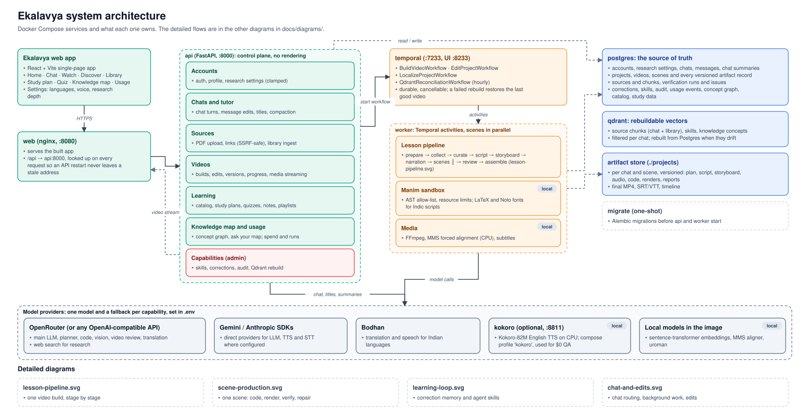

# Ekalavya

**An AI STEM tutor that answers in chat or turns a question into a narrated, animated video lesson, in English or an Indian language.**

Ask Ekalavya something like *"Explain Fourier series visually, in Tamil"*. Ekalavya then:

1. plans a short lesson;
2. writes and reviews the script;
3. animates every scene with [Manim](https://www.manim.community/);
4. narrates it with TTS;
5. checks each rendered scene, and repairs the ones that fail;
6. delivers an MP4 with chapters and captions.

You can then talk to the video. For example, *"2:10 to 2:30, use a simpler example"* rebuilds only the scenes in that time range.

Named after Ekalavya, the self-taught archer of the Mahabharata who learned by watching.

---

## Key features

**Tutor chat**
- **Chat or video is the model's decision.** A planner agent reads the conversation and decides whether a request needs a text answer or a video lesson. No magic keywords are needed.
- **Edit and branch.** Edit any earlier message and resend it. The old turn is kept as a branch you can step through with ‹ ›.
- **Checked answers.** Worked examples in a reply are recomputed, and every numeric equation must hold. Citations such as `[paper, p. 3]` must point to a retrieved page that contains the cited numbers. A failing reply is regenerated once with the errors named; anything still unverified is stated in a note.
- **Voice input**, quoted replies, copy, light/dark themes, chats grouped into folders, and temporary (unsaved) chats.
- **Long chats.** The last turns stay in view word for word; older ones are folded into a running summary in the background (only once they get long), keeping standing preferences, decisions and every video made. Editing a summarised message rebuilds the summary from the new branch.
- **Research depth** (Settings → *Research depth*): web searches per video (default 3, up to 10), results per search, web pages read in full, library queries and passages, the whole-source and one-pass reading limits, lookups per writing step, and chat turns kept. The page shows the expected extra cost and time per video from your own usage; the server clamps every value to its range.

**Lessons from your own sources**
- **Your material.** Attach a PDF or paste a link (PDF or web page/blog) in chat.
- **Source choice.** Ekalavya asks whether to use *only your source* or *also add outside web sources*, then follows that choice.
- **Unreadable sources.** If a link can't be read, it says so instead of quietly substituting other material.

**Multilingual by design**
- **Languages.** Lessons and chat in English, Hindi, Tamil, Telugu, Bengali, Marathi, plus Arabic, French, Japanese and Spanish.
- **Separate text and voice languages.** For example, Tamil captions with English narration.
- **English canonical copy.** Planning, scripts and scene specs stay in English. Only learner-visible text and narration are translated, right before rendering and TTS. Equations are locked, so translation never corrupts notation.
- **Language changes.** Asking for the same video in another language builds a new version. Earlier versions stay available in the chat.
- **Checked translation.** Translation is verified, not trusted:
  - numbers, units, years, equations and each lesson's key STEM terms become placeholders before translation;
  - names are found with spaCy's small English NER model;
  - each result is checked by matching (placeholders intact, no invented digits, names present, possibly after romanizing a transliteration, not cut off or left untranslated);
  - a failed line gets one corrected retry, otherwise screen text stays in English.
- **STEM terms in English.** On screen a term reads `photoelectric effect (ஒளிமின் விளைவு)`; the narration says only the English term.
- **Numbers spoken properly.** The narration says numbers as words in its own language ("ஆயிரத்து தொள்ளாயிரத்து ஐந்து" for 1905) and units by name, while the screen keeps digits.
- **Bodhan AI.** With a Bodhan key, translation and narration for Indian languages use Bodhan's Indic models, with one female voice per language; everything else stays on OpenRouter.

**Quality and self-correction**
- **Whole-lesson script review.** The full script is checked for correctness, flow, and a proper ending.
- **Checks on every rendered scene:**
  - render errors;
  - raw-LaTeX text shown on screen;
  - layout overlap and out-of-frame objects;
  - required equations;
  - pedagogy;
  - audio/visual sync, reviewed by a vision model.
- **Bounded repair.** Failing scenes enter a bounded repair loop. A final whole-lesson review can rebuild up to 3 weak scenes before assembly.
- **Speech timing.** Forced alignment of the narration audio times each visual to the spoken word. Visuals that would start after a scene's narration ends are skipped and sent for repair, so nothing is cut off at a scene change.
- **Always a video.** When repairs run out, a scene falls back, in order, to:
  1. its attempt with only cosmetic issues;
  2. a plain title-and-equation scene;
  3. its best-scoring rendered attempt;
  4. the narration over a still frame.

  The lesson ships and says which scenes were degraded.

**Robust and safe**
- **Sandboxed renders.** Generated Manim code is checked statically (an AST allow-list) before rendering. It then renders in a sandbox with CPU, memory and file limits.
- **Safe link fetching.** Links must be public HTTPS (SSRF-safe, size-capped). PDF text is sanitized before storage.
- **Durable jobs.** Builds run as Temporal workflows. A failed rebuild restores the previous working video.
- **Model fallbacks.** Every model capability has a fallback model.

**Learning beyond the chat**
- **Landing page** for visitors, with public explainer videos and sign-up.
- **Home:** greeting, quick actions (explain, make a video, summarize a paper, quiz me), *Continue learning* from where you stopped, today's study tasks, and recommendations.
- **Discover:** a public catalog. Any learner can publish a finished video; the catalog agent writes its title, summary, subject and keywords. Search needs every keyword; when nothing matches, the closest videos by meaning are offered. Subjects are the model's own words, so the filters grow with the catalog.
- **Video page:** chapters, Notes pinned to moments, a searchable Transcript, Resources (the sources used), Practice, Save, Playlist, Share, Download and related videos.
- **Library:** your videos and saved ones, documents you attached, all your notes, and playlists.
- **Study plan:** state a goal, a date and minutes per day. The study planner agent schedules watching, practice, reading, review, and new videos for gaps. A weekly progress ring, today's tasks, a calendar, and *Replan* from today when life happens.
- **Quiz me:** the quiz agent writes questions from a video's narration, or on a topic. Written answers are graded by the model, and each wrong answer links to the scene that explains it.
- **Recommendations and related videos** rank by embedding similarity to what you study, not by rules.
- **Knowledge map** (sidebar → *Knowledge map*): a graph of every concept from your chats and lessons and how they relate. An agent reads each chat, names the concepts and relations in its own words, and reuses existing concept names so one idea stays one node across chats. The graph lives in PostgreSQL; each concept's vector is also indexed in Qdrant. Explore it as an interactive force graph, find concepts by meaning, or *Ask your map*: the question finds the closest concepts, widens to their neighbours, and the answer uses only those facts, citing the concepts and chats.
- **Chat titles** are written by the model from your first message, in the language you wrote in. Renaming a chat keeps your title.

**Usage & activity dashboard** (sidebar → *Usage*)
- **Totals:** spend, tokens, videos built, average build time, success rate and retries, for 7, 30 or 90 days, or all time.
- **Live runs:** an Airflow-style graph of the lesson stages, with a lane per scene showing what is done, running and next.
- **Breakdowns:** spend per day and per module (script, Manim code, code repair, video review, translation, narration and more).
- **Per chat:** spend by module and by scene, a stage timeline of each run, and every model call with its cost, time and outcome.
- **Admin view:** usernames listed in `ADMIN_USERNAMES` can switch to all users.

---

## Architecture



**Main components:**
- **PostgreSQL** holds the authoritative records: accounts, chats, projects, and every versioned artifact (script, spec, code, audio, render, video).
- **Qdrant** holds only embeddings that can be rebuilt.
- **Temporal** makes long builds durable and cancellable.

More detail is in [docs/system-design.md](docs/system-design.md), with diagrams of:
- [one video build](docs/diagrams/lesson-pipeline.svg);
- [one scene](docs/diagrams/scene-production.svg);
- [correction memory and skills](docs/diagrams/learning-loop.svg);
- [chat turns and edits](docs/diagrams/chat-and-edits.svg).

### The lesson pipeline

| Stage | What happens | Code |
|---|---|---|
| Prepare | Planner LLM reads the chat: chat vs. video, languages, duration, source links and scope | `agents/lesson_preparation.py`, `api/tutor.py` |
| Collect | The planner splits the brief into focused queries; your sources and the library are searched with all of them at once (Qdrant, this chat's and library passages only) and, where outside material is allowed, several web searches run in parallel | `retrieval/collection.py`, `retrieval/qdrant_retrieval.py`, `api/service.py` |
| Curate | The lesson curator reads everything collected and writes one lesson plan: sections, key points, worked examples with their numbers, the source's wording, visual ideas, and references to detail it left out. A reviewer checks the plan against the material and the curator fixes gaps once. Material larger than the one-pass limit is read in parallel groups, each checked, then merged. Paper lectures use the paper outline instead | `agents/lesson_curator.py`, `agents/paper_outline.py` |
| Script | Drafts the whole lesson in English from the plan only (looking up referenced passages if it needs them), then self-reviews and revises | `agents/script_writer.py`, `agents/reference_lookup.py` |
| Storyboard | Plans visual beats per scene from the narration and its part of the plan, with the same lookups | `agents/storyboard_agent.py` |
| Produce | TTS → forced alignment → Manim code → sandboxed render, scenes in parallel | `services/orchestration.py`, `agents/code_generator.py`, `manim_runtime/` |
| Verify / repair | Layout, math, pedagogy, raw-TeX and A/V checks; bounded repair loop | `verification/`, `agents/manager.py` |
| Review | Whole-lesson coherence review; rebuilds ≤3 weak scenes | `services/orchestration.py` |
| Assemble | FFmpeg concatenation, SRT/VTT captions, chapters | `media/ffmpeg.py`, `media/subtitles.py` |

---

## Running Ekalavya

Ekalavya runs with Docker on Windows, macOS and Linux, using the same command on each.

**Prerequisites**
- [Docker Desktop](https://www.docker.com/products/docker-desktop/) (Windows/macOS) or Docker Engine with the Compose plugin (Linux).
- An [OpenRouter](https://openrouter.ai/) API key, or another provider; see [Configuration](#configuration).
- About 8 GB of free disk space for the image and the models it downloads on first use.

**1. Get the code and create `.env`:**

```bash
git clone <this-repo> Ekalavya
cd Ekalavya
cp .env.example .env          # Windows PowerShell: Copy-Item .env.example .env
```

**2. Edit `.env`:**
- set `APP_API_KEY` to any random string;
- add your provider settings (see [Configuration](#configuration)).

**3. Build and start everything:**

```bash
docker compose up --build
```

The first build takes about 10–15 minutes. It installs Manim, LaTeX, FFmpeg, CPU PyTorch and Noto fonts for Indic scripts. Later starts take seconds. Compose runs:
- PostgreSQL, Qdrant and Temporal;
- a one-shot database migration;
- the API, the worker and the web app.

**Stopping and data:**
- `Ctrl+C` or `docker compose down` stops the stack.
- Chats and accounts stay in Docker volumes, and videos in `./projects` (or `PROJECTS_DIR`), one folder per user: `<owner_id>/<project_id>/`. Both survive restarts.
- `docker compose down -v` also deletes your chats.
- `docker compose logs -f worker` follows the lesson pipeline.
- For a smaller image without LaTeX, run `docker compose build --build-arg WITH_LATEX=0`. Equations then render as Unicode text.

<details>
<summary>Developing without Docker (Windows)</summary>

The project was developed natively on Windows. `scripts/setup-local.ps1` does the one-time setup:
- creates a Conda env;
- writes `.env`;
- downloads Qdrant and Temporal into `.local/`;
- initializes PostgreSQL.

`scripts/start-local.ps1` and `scripts/stop-local.ps1` start and stop all services. Logs go to `.local/logs/`.

```powershell
powershell -ExecutionPolicy Bypass -File scripts\setup-local.ps1
powershell -ExecutionPolicy Bypass -File scripts\start-local.ps1
```

For the React app with hot reload, run `npm install` then `npm run dev` in `web/` and open http://127.0.0.1:5173. The dev server forwards `/api` to the API at `EKALAVYA_API_URL` (default `http://127.0.0.1:8000`) and adds `APP_API_KEY` from `.env`.
</details>

### Open the app

| | URL |
|---|---|
| **App** | http://127.0.0.1:8080 |
| API docs (OpenAPI) | http://127.0.0.1:8000/docs |
| Temporal UI | http://127.0.0.1:8233 |

Click **Create account**, sign in, and try:
- `What is the derivative of sin x?` gets a chat answer.
- `Explain the Pythagorean theorem visually in Hindi` starts a video lesson.
- `Make a video from this blog: https://…` makes Ekalavya ask whether to use only that source.
- After a video finishes: `0:20 to 0:40, slow down and add a worked example`.

---

## Configuration

All settings live in `.env`. [.env.example](.env.example) documents every variable. Each capability (main LLM, planner, code, translation, vision, video review, TTS, STT, embeddings) is configured independently, with an optional fallback model. Set a capability's provider to `mock` (or leave it blank) to use deterministic mocks, which are useful for offline tests.

`.env.example` ships with the reference setup below, so on a new machine you only need to fill in `OPENROUTER_API_KEY` (and `APP_API_KEY` if you don't run `setup-local.ps1`):

```dotenv
APP_API_KEY=<any random string>
OPENROUTER_API_KEY=<your key>

MAIN_LLM_PROVIDER=openai_compatible
MAIN_LLM_BASE_URL=https://openrouter.ai/api/v1
MAIN_LLM_MODEL=anthropic/claude-sonnet-5.5        # script writing and review
MAIN_LLM_FALLBACK_MODELS=google/gemini-3.8-flash
PLANNER_LLM_MODEL=anthropic/claude-haiku-5.5      # chat/video intent, storyboard, lesson review

CODE_PROVIDER=openai_compatible
CODE_BASE_URL=https://openrouter.ai/api/v1
CODE_MODEL=anthropic/claude-sonnet-5.5            # Manim code

TRANSLATION_PROVIDER=openai_compatible
TRANSLATION_BASE_URL=https://openrouter.ai/api/v1
TRANSLATION_MODEL=google/gemini-2.5-flash-lite

VISUAL_LLM_PROVIDER=openai_compatible
VISUAL_LLM_BASE_URL=https://openrouter.ai/api/v1
VISUAL_LLM_MODEL=google/gemini-3.8-flash          # keyframe review

TTS_PROVIDER=openai_compatible
TTS_BASE_URL=https://openrouter.ai/api/v1
TTS_MODEL=google/gemini-3.8-flash-lite-tts
TTS_VOICE=Kore
TTS_RESPONSE_FORMAT=pcm

# Optional: Bodhan AI for Indian-language translation and narration
BODHAN_API_KEY=<your Bodhan key>
BODHAN_TTS_VOICE=Kavya                            # female; per language: BODHAN_TTS_VOICES=ta:Name,...

STT_PROVIDER=openai_compatible
STT_BASE_URL=https://openrouter.ai/api/v1
STT_MODEL=openai/whisper-large-v3                 # voice input

EMBEDDING_PROVIDER=local                          # sentence-transformers, runs on CPU
```

**Other providers.** Capabilities whose base URL is OpenRouter use `OPENROUTER_API_KEY`; `gemini` providers fall back to `GEMINI_API_KEY`; others use their own `*_API_KEY`. Other backends are also supported:
- Gemini directly (`*_PROVIDER=gemini`);
- Anthropic (`anthropic`);
- ElevenLabs or a local Kokoro server for TTS;
- local vLLM endpoints (`openai_compatible` with a local `*_BASE_URL`).

**Cost.** A 1–2 minute lesson typically costs about $0.20–0.30 with the setup above. Usage and cost are recorded for each project.

---

## Project structure

```
Ekalavya/
├── web/                      React app (Vite, TypeScript, Tailwind), served by nginx
│   ├── src/pages/              Landing, Home, Chat, Discover, Watch, Library, Study, Quiz, Usage
│   ├── src/components/         app shell, video player, cards, chat composer and progress
│   └── nginx.conf.template     serves the app; proxies /api to FastAPI and adds the API key
├── frontend/                 previous Streamlit UI
│   ├── app.py                  chat, sidebar/folders, player, edit & branch UI, settings
│   ├── dashboard.py            usage & activity dashboard page
│   ├── assets/                 logo (ழ)
│   └── components/             caption track, auth-cookie bridge
├── src/scholarmotion/        backend package (internal name kept from the project's working title)
│   ├── api/                    FastAPI app
│   │   ├── main.py               routes: auth, chats, messages, sources, builds, edits, media
│   │   ├── tutor.py              chat turn routing (answer / start video / edit / ask about sources)
│   │   ├── service.py            build, edit and localization services; video versions
│   │   ├── learning.py           catalog, library, notes, playlists, home, study plans, quizzes
│   │   ├── knowledge.py          knowledge map: concept graph, semantic search, graph questions
│   │   ├── capabilities.py       per-capability endpoints (/v1/capabilities/*)
│   │   └── usage.py              usage dashboard API (/v1/usage/*)
│   ├── agents/                 LLM agents: lesson preparation, curriculum, script writer,
│   │                           storyboard, Manim code generator, repair manager,
│   │                           video catalog, study planner, quiz writer, concept graph, chat titles
│   ├── services/orchestration.py  the lesson pipeline (scenes in parallel, review, repair, assembly)
│   ├── manim_runtime/          sandbox renderer, AST validator, layout components, templates
│   ├── verification/           render, layout, math, pedagogy, grounding and chat-reply checks
│   ├── media/                  TTS orchestration, forced alignment, FFmpeg, subtitles
│   ├── retrieval/              PDF + web-page parsing, safe link fetching, Qdrant retrieval
│   ├── translation/            checked localization: entity masking (spaCy NER), checks, spoken numbers
│   ├── providers/              LLM / TTS / STT / embedding adapters, Bodhan, factory with fallbacks
│   ├── persistence/            SQLAlchemy models, database, object storage
│   ├── workflows/              Temporal workflows, activities, worker
│   ├── skills/                 versioned agent skills stored in PostgreSQL
│   ├── observability/          JSON logs, Prometheus metrics, usage/cost tracking
│   ├── config/                 typed settings from .env
│   └── schemas/                shared Pydantic models
├── alembic/                  database migrations
├── Dockerfile, docker-compose.yml   containerized stack (any OS)
├── tests/                    pytest suite (unit + mocked end-to-end)
├── scripts/
│   ├── setup-local.ps1         native Windows dev setup (optional; Docker is the default)
│   ├── start-local.ps1         start native services
│   ├── stop-local.ps1          stop native services
│   ├── ingest_ncert.py         bulk-index NCERT textbook PDFs
│   ├── kokoro_server.py        optional local Kokoro TTS server
│   └── qa/                     live QA harnesses (browser, scenarios, multilingual, edits)
└── docs/                     system design, test plan and reports
```

---

## Tests

```powershell
conda activate scholarmotion
pytest -q        # ~400 tests, all offline: providers, DB and media are mocked or in-memory
ruff check src tests frontend
cd web && npm ci && npm run build    # type-checks and builds the React app
```

The suite covers:
- lesson preparation and chat routing;
- the source-scope policy (only the given source vs. given + web);
- video versioning and restore;
- message edit and branching;
- forced alignment and timing;
- layout and LaTeX validation;
- FFmpeg assembly;
- auth;
- provider fallbacks;
- a mocked end-to-end build.

The `scripts/qa/` harnesses drive the real running app, through its API and through a headless browser, for live checks.

---

## API

The full API is documented at `/docs`. Every route except `/health`, `/docs` and `/openapi.json` needs either a signed-in session or the `X-API-Key` client key. Main groups:

- `/v1/auth/*`: register, login, logout, account settings.
- `/v1/projects/*`: chats/projects, messages, sources (`/sources`, `/sources/link`), progress, videos, scene edits.
- `/v1/capabilities/*`: each model capability on its own (code, vision, TTS, STT, translation).
- `/v1/skills/*`: versioned agent skills with progressive disclosure.
- `/v1/usage/summary`, `/v1/usage/chats/{id}`, `/v1/usage/live`: the usage dashboard's data.
- `/v1/videos/*`: the public catalog and search, a video's media, transcript, notes, progress, saves, sources, and publishing (open to visitors for public videos).
- `/v1/library/*`, `/v1/home`, `/v1/study-plans/*`, `/v1/quizzes/*`: library, playlists, home feed, study plans and quizzes.
- `/v1/knowledge/*`: the knowledge map (`sync`, `graph`, `nodes/{id}`, `search`, `query`).
- `/metrics`: Prometheus counters for latency, provider fallbacks and workflow outcomes.

---

## Known limitations

- **Performance:** rendering and speech alignment run on the CPU, so a lesson takes several minutes on a laptop.
- **Sandboxing:** the render sandbox uses resource limits. Full network isolation (`SANDBOX_ISOLATION=required`, bubblewrap) is available only on Linux.
- **Lesson length:** set by the planner, up to 30 minutes. Very long lessons cost more and take longer to build.
- **Bodhan:** the Bodhan adapters are covered by tests against the documented API, but have not yet been run against the live service (no key was available). Without a key everything runs on OpenRouter.
- **Web sources:** web-page extraction is readability-style. Pages that need JavaScript to render must be attached as a PDF instead.
