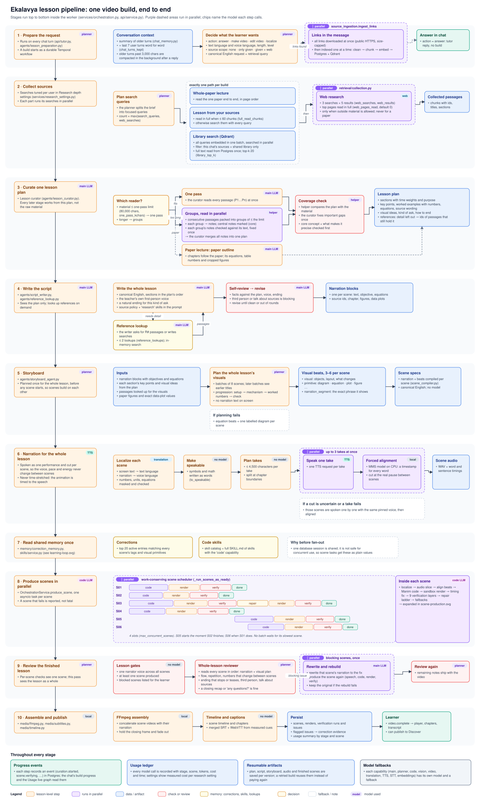
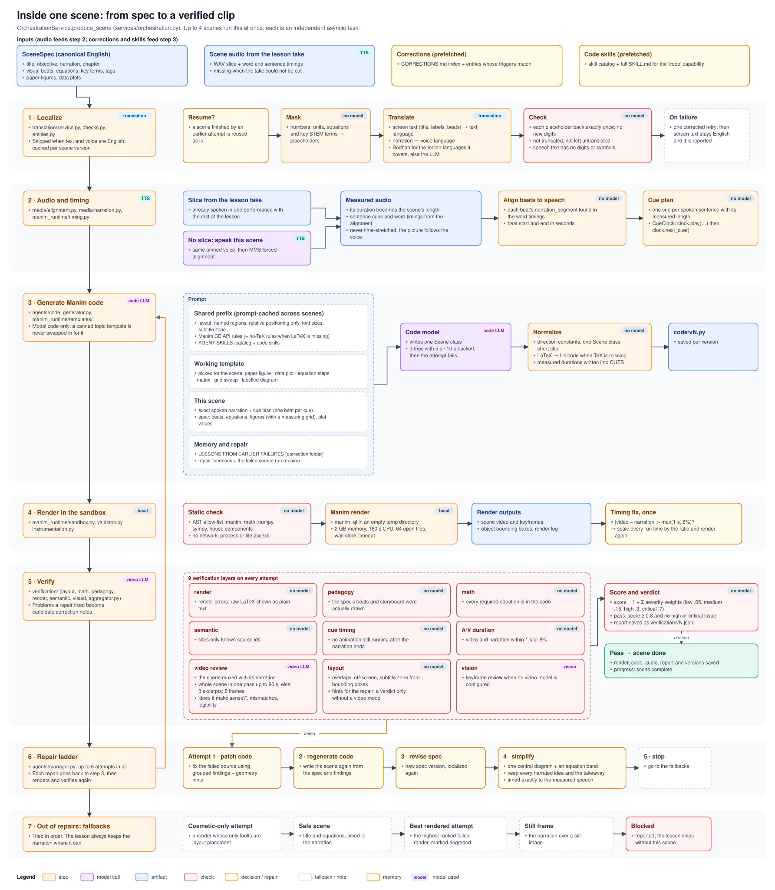
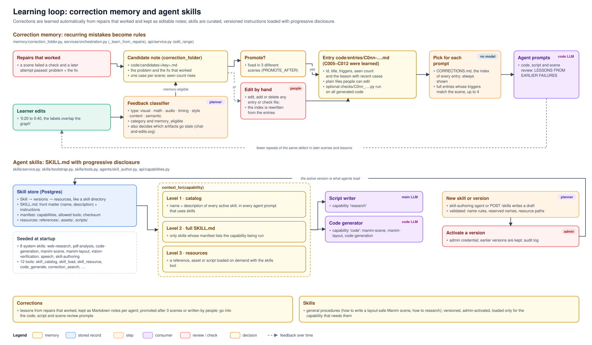
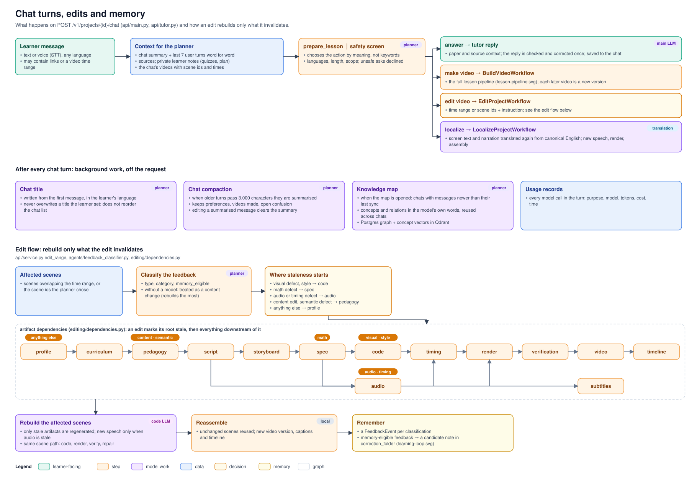

# Ekalavya system design

Five diagrams, from the whole system down to a single scene. They are generated from
[diagrams/make_diagrams.py](diagrams/make_diagrams.py), which uses only the standard library:

```bash
python docs/diagrams/make_diagrams.py            # all diagrams
python docs/diagrams/make_diagrams.py scene-production.svg
```

Each box names the module where its behaviour lives. When you change the pipeline, update the
text there and regenerate the diagrams.

| Diagram | Shows |
|---|---|
| [architecture.svg](diagrams/architecture.svg) | Services, what each owns, and the providers they call |
| [lesson-pipeline.svg](diagrams/lesson-pipeline.svg) | One video build, stage by stage, with the parallel parts |
| [scene-production.svg](diagrams/scene-production.svg) | One scene: localize, audio, code, render, verify, repair, fallbacks |
| [learning-loop.svg](diagrams/learning-loop.svg) | Correction memory and agent skills |
| [chat-and-edits.svg](diagrams/chat-and-edits.svg) | A chat turn, background work, and how edits rebuild only what is stale |

## 1. System


- **web (nginx)** serves the React app. It proxies `/api` to the API and looks the API's
  address up on every request, so restarting the API never leaves nginx with a stale address.
- **api (FastAPI)** is the control plane:
  - accounts, chats, sources, videos, learning, the knowledge map, usage, and admin
    capabilities;
  - it reads and writes Postgres and Qdrant, and starts Temporal workflows;
  - it never renders. Chat titles and chat compaction run as background tasks after the
    response is sent.
- **temporal and the worker** run the long jobs. There are four workflows: build, edit,
  localize, and an hourly Qdrant reconciliation. The worker holds the lesson pipeline, the Manim
  sandbox (with LaTeX and Noto fonts) and the media tools (FFmpeg, MMS forced alignment).
- **Data:**
  - **Postgres** is the source of truth.
  - **Qdrant** holds only rebuildable vectors: source chunks, skills, knowledge concepts and
    learners' answered quiz questions.
  - **The artifact store** (`./projects`) holds every versioned file. Rendered videos are
    streamed back through the API.
- **Providers** are set per capability in `.env`, each with its own model and a fallback. The
  capabilities are:
  - main LLM, planner, code, vision, video review, translation, TTS, STT, embeddings, and the
    safety screen.

  Kokoro is an optional local English TTS service (compose profile `kokoro`), used for $0 QA
  runs with `docker-compose.qa-free.yml`.

## 2. One video build



1. **Prepare.** The planner reads the conversation: the chat summary plus the last 7 user
   turns word for word. It decides between answer, video, edit and localize, and settles the
   languages, length, level and source scope. Links in the message are downloaded in parallel,
   then indexed one at a time.
2. **Collect.** The planner writes several focused queries. Exactly one material path is used:
   - the whole paper, for a paper lecture;
   - the learner's own sources, read in full when small;
   - the library, through Qdrant. All queries are embedded in one batch and searched in
     parallel, filtered to this chat plus the shared library.

   Web searches run in parallel when outside material is allowed. Each user sets the counts in
   *Settings → Research depth*, which shows the measured cost and time.
3. **Curate.** The lesson curator writes the one lesson plan that every later stage works from.
   - Material within the one-pass limit (80,000 characters by default) is read at once.
   - Longer material is split into groups. Each group is read in parallel, its notes are
     checked against its own text, and the notes are merged.
   - A helper model then checks the plan for coverage, and the curator fixes gaps once.
   - Detail that doesn't fit becomes references to passages that stay retrievable.
   - Paper lectures use the paper outline instead.

   See [context-management-test-2026-10-28.md](context-management-test-2026-10-28.md) for the
   test showing that this keeps the core explanation.
4. **Script.** The whole lesson is written in canonical English from the plan only, in the
   teacher's first-person voice with a natural ending. The writer can look up up to 2
   references, then self-reviews and revises.
5. **Storyboard.** It is planned once for the whole lesson, in batches of 8 scenes, so scenes
   build on each other instead of repeating. Each scene gets 3–6 beats, and each beat quotes the
   narration phrase it shows. The beats are then compiled into one SceneSpec per scene.
6. **Narration.** The whole lesson is spoken as one performance: up to 3 takes in parallel,
   each at most 4,500 characters, split at chapter boundaries. Each take is force-aligned word
   by word and cut at the real pauses between scenes. That's why the voice never changes from
   scene to scene. The audio is never time-stretched; the animation follows the speech.
7. **Shared memory.** Corrections and code skills are read once before the scenes fan out. The
   database session can't be used concurrently, so scene tasks get them as plain values.
8. **Scenes in parallel.** A work-conserving scheduler runs 4 scenes at once
   (`max_concurrent_scenes`). The next scene starts the moment any scene finishes; no batch waits
   for its slowest scene.
9. **Lesson review.** Before review, the lesson must pass some gates: one narrator voice, at
   least one scene produced, and blocked scenes listed. A reviewer then reads the whole lesson
   in order. Each blocking scene gets its narration rewritten and is rebuilt in parallel, once;
   if the rebuild fails, the original scene is kept.
10. **Assemble.** FFmpeg joins the scenes, holds the closing frame and fades out. Captions come
    from the measured cues. Everything is saved, and repairs that worked become correction
    notes.

Throughout the build:
- every step records a progress event;
- every model call is recorded in the usage ledger;
- every artifact is saved per version, so a retried build resumes instead of paying again.

### Why storyboard and narration are not per scene

Both run once for the whole lesson, before the parallel scenes start:
- **Storyboard:** planning visuals per scene in isolation repeats the same picture and loses
  the lesson's progression.
- **Narration:** speaking each scene separately lets the voice's pitch, pace and energy drift
  between scenes.

Each scene then takes its slice: its beats, and its cut of the audio with measured word timings.

## 3. Inside one scene



1. **Localize.**
   - Numbers, units, equations and key terms are masked before translation.
   - The translation is checked: every placeholder comes back once, no new digits, nothing
     truncated or left untranslated.
   - A failed translation gets one corrected retry. If that also fails, the screen text stays
     English and the failure is reported.
2. **Audio and timing.**
   - The scene uses its slice of the lesson take, or, if there is no slice, it is spoken alone
     in the same pinned voice and aligned.
   - Its measured length becomes the scene's length.
   - Beats are anchored to the word timings, and the cue plan has one cue per sentence.
3. **Code.**
   - The prompt opens with a shared prefix that is prompt-cached across scenes: layout rules,
     Manim API rules and code skills.
   - Then come a working template matched to the scene, the narration with its cue plan, the
     spec, the relevant corrections, and, on repairs, the findings and the failed source.
   - The code model gets 3 tries with backoff.
   - The output is normalized before rendering.
4. **Render.**
   - The code passes an AST allow-list.
   - It renders in a sandbox: 2 GB memory, 180 s CPU, 64 open files, and a timeout.
   - If the video and narration differ by more than max(1 s, 8%), the run times are scaled and
     the scene renders again, once.
5. **Verify.** Nine layers run on every attempt:
   - render, pedagogy, math, semantic, cue timing, A/V duration;
   - video review: the scene muxed with its narration, judged as a whole;
   - layout geometry;
   - keyframe vision, used only when no video model is configured.

   The score is 1 minus the sum of the issues' severity weights. A scene passes at 0.8 or above
   with no high or critical issue.
6. **Repair ladder.** The attempts escalate in order: patch the code, regenerate it, revise the
   spec, then simplify. Each repair goes back to code generation, then renders and verifies
   again.
7. **Fallbacks.** When the repairs run out, the scene uses the first available option:
   - a cosmetic-only attempt;
   - a safe title-and-equations scene;
   - the best rendered attempt, marked degraded;
   - the narration over a still frame.

   Otherwise the scene is blocked, and the lesson ships without it.

## 4. Correction memory and agent skills



**Corrections** are lessons from past failures, kept as a folder of Markdown notes per agent
(`correction_folder/` with `code/`, `script/`, `storyboard/` and `review/`;
`memory/correction_folder.py`). People can read, edit, add or delete any file.
- **Cases** come from two places:
  - repairs that worked: a scene failed a check and a later attempt passed, so the problem and
    the fix are recorded (`_learn_from_repairs` in `services/orchestration.py`);
  - learner edits that the feedback classifier marks as memory-eligible (`edit_range` in
    `api/service.py`).
- **Candidates.** Each case is added to a note in `candidates/`, one per kind of problem.
- **Promotion.** A candidate fixed in 3 different scenes (`PROMOTE_AFTER`) becomes an entry in
  `entries/` (`C0nn-….md`), and the `CORRECTIONS.md` index is rewritten. An entry can have a
  check in `checks/`, a small Python function that runs on every generated code and reports
  findings as verification issues.
- **Use.** The agent always sees the index. The full text of up to 4 entries whose triggers
  match the scene (its tags, visual primitives or failing checks) is added under *LESSONS FROM
  EARLIER FAILURES*. The code writer, the script writer and the scene reviewer each read their
  own folder.

**Skills** follow the SKILL.md format, stored in Postgres as skill → versions → resources.
- **Seeding.** Eight system skills and twelve tools are added at startup.
- **Progressive disclosure:**
  - every prompt that uses skills sees the catalog (names and descriptions);
  - the full SKILL.md is loaded only for skills whose manifest lists the capability being run:
    `research` for the script writer, `code` for the code generator;
  - resources are loaded on demand with the skills tool.
- **New versions** come from the skill-authoring agent or `POST /skills`. An admin activates a
  version; earlier versions are kept.

## 5. Chat turns and edits



- **Safety screen.** Every message is checked by a small model (`GUARDRAIL_MODEL`,
  `agents/guardrail.py`) while the planner runs, so it adds almost no wait. Politics, hate,
  dangerous or cheating requests get a gentle decline; the educational side of a topic is
  allowed. If the screen itself fails, `GUARDRAIL_ALLOW_ON_ERROR` decides (default: allow).
- **Learner notes.** The planner also gets private notes on the learner
  (`services/learner_record.py`): each quiz's latest score, stronger and weaker topics, the
  quiz answers closest to the current topic (from Qdrant), the active study plan and related
  concepts. They shape lessons, quizzes and study plans, and are never mentioned unless the
  learner asks about their own results. They are built when needed; nothing is scheduled.
- **Routing.** The planner chooses the action by meaning, not by keywords:
  - **answer** gives a checked tutor reply;
  - **make video** starts a build;
  - **edit** starts an edit;
  - **localize** translates the video again from canonical English.
- **After each turn**, work runs in the background:
  - the chat title is written from the first message;
  - older turns are compacted once they pass 3,000 characters; editing a summarised message
    clears the summary;
  - the knowledge map syncs chats with new messages when the map is opened.
- **Edits.** The feedback classifier decides where staleness starts:
  - visual or style → code;
  - math → spec;
  - audio or timing → audio;
  - content or semantic → pedagogy;
  - anything else → profile.

  Everything downstream of that point in the artifact graph is rebuilt, for the affected scenes
  only. The video is then reassembled, and memory-eligible feedback becomes a case in the
  correction folder.
